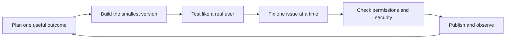

# Vibe Coding with Base44

> A practical, beginner-friendly guide to turning an idea into a working full-stack app with Base44—using plain-English prompts instead of starting with code.
>
> **Affiliate disclosure:** Some links in this guide are affiliate links. If you create or upgrade a Base44 account through them, I may earn a commission at no extra cost to you. That support helps keep this guide free and updated. Recommendations are based on usefulness, not commission.

[Start building with Base44](https://base44.pxf.io/c/6763812/2049275/25619?subId1=github&trafcat=base) · [Read the 15-minute quick start](docs/00-start-here.md) · [Copy proven prompts](docs/02-prompt-playbook.md)

---

## What you will learn

This is not a list of features or a collection of vague prompt tips. It is a start-to-launch path for people who have an idea but do not yet think of themselves as developers.

- Turn a rough idea into a buildable first version
- Write prompts that produce predictable changes
- Model data without needing database jargon
- Add login, roles, and safe data permissions
- Connect external tools and automate workflows
- Test the important user journeys before publishing
- Diagnose common problems without starting over
- Move into GitHub and local development when you are ready

## Pick your path

| If you want to...                            | Start here                                                      |
| -------------------------------------------- | --------------------------------------------------------------- |
| Build something today                        | [Start here](docs/00-start-here.md)                             |
| Follow one complete project                  | [Build your first app](docs/01-build-your-first-app.md)         |
| Improve weak or inconsistent results         | [Prompt playbook](docs/02-prompt-playbook.md)                   |
| Understand tables, login, roles, and privacy | [Data, auth, and security](docs/03-data-auth-security.md)       |
| Add email, AI, APIs, and automations         | [Integrations and workflows](docs/04-integrations-workflows.md) |
| Find and fix bugs                            | [Testing and debugging](docs/05-testing-debugging.md)           |
| Publish a real product                       | [Launch checklist](docs/06-launch-checklist.md)                 |
| Use code, GitHub, the SDK, or CLI            | [Developer path](docs/07-developer-path.md)                     |
| Grab a ready-to-paste prompt                 | [Prompt library](prompts/README.md)                             |
| Fix a specific problem                       | [Troubleshooting](docs/troubleshooting.md)                      |

## Base44 in one minute

Base44 is an AI app builder. You describe the product in natural language, and it can create the interface, data tables, authentication, logic, and hosted app. You keep refining it through chat, visual edits, and—when needed—code.

The most useful mental model is a loop:

You are still the product owner. The AI can implement quickly, but you decide who the app is for, what data it may expose, what “working” means, and when it is safe to ship.

## The beginner workflow that works

1. **Choose one user and one painful job.** “A tool for everyone” is not a useful starting point.
2. **Use Plan mode before the first build.** Confirm the audience, core flow, tables, roles, and visual direction.
3. **Build the happy path first.** Make one complete journey work before adding extra pages.
4. **Refine in small prompts.** One outcome per prompt makes changes easier to review and revert.
5. **Use Discuss mode for decisions.** Explore architecture or UX without changing the app.
6. **Use Edit mode for visual polish.** Manual visual edits do not consume message credits.
7. **Test permissions as different users.** A polished app that leaks another user's data is not ready.
8. **Run tests and the security scan.** Then publish to a small group before promoting widely.

## What to build first

Good first projects have one main workflow and a small data model:

- Personal habit tracker
- Client inquiry manager
- Content calendar
- Simple booking request app
- Inventory or equipment checkout tool
- Customer portal with status updates
- Niche directory with an admin dashboard

Avoid starting with a marketplace, social network, regulated-health product, bank-like product, or multi-tenant SaaS with complex billing. Those are possible later, but they multiply permissions, failure modes, and legal responsibilities.

## Current plan notes

Features and limits change, so check [Base44's official billing documentation](https://docs.base44.com/Account-and-billing/Billing-and-plans) before paying. As of **July 27, 2026**:

- The Free plan includes core building features, authentication, database functionality, analytics, up to 5 apps, up to 25 monthly message credits (currently capped at 5 per day), and 100 monthly integration credits.
- Starter adds unlimited apps and in-app code edits.
- Builder is the first listed plan with backend functions, custom domains, GitHub integration, and manual model selection.
- New private apps require a paid plan.

Base44 is rolling out plan and workspace changes, so some accounts may show different limits or behavior. Start free, validate that Base44 fits your project, and upgrade when a required capability—not impatience—justifies it.

## A note on affiliate links

The primary Base44 link in this repository is an affiliate link. You can always visit [Base44 directly](https://base44.com/) instead. Both routes should lead to the same product; using the affiliate link is an optional way to support this guide.

Read the full [affiliate disclosure](AFFILIATE-DISCLOSURE.md).

## Accuracy and scope

This is an independent community guide, not official Base44 documentation and not affiliated with or endorsed by Base44 or Wix. Interfaces, plan limits, model names, and beta features can change. Each chapter links to official documentation so you can verify time-sensitive details.

Found something stale? [Open an issue](https://github.com/cporter202/vibe-coding-with-base44/issues) or read [CONTRIBUTING.md](CONTRIBUTING.md).

## Official references

- [Base44 documentation](https://docs.base44.com/)
- [Quick-start guide](https://docs.base44.com/Getting-Started/Quick-start-guide)
- [Prompt guide](https://docs.base44.com/Getting-Started/Prompt-guide)
- [Security overview](https://docs.base44.com/Setting-up-your-app/security-overview)
- [Billing and plans](https://docs.base44.com/Account-and-billing/Billing-and-plans)
- [Base44 developer platform](https://docs.base44.com/developers/home)

---

If this guide helps you build your first useful app, [try Base44 here](https://base44.pxf.io/c/6763812/2049275/25619?subId1=github&trafcat=base) and tell the community what you made.
