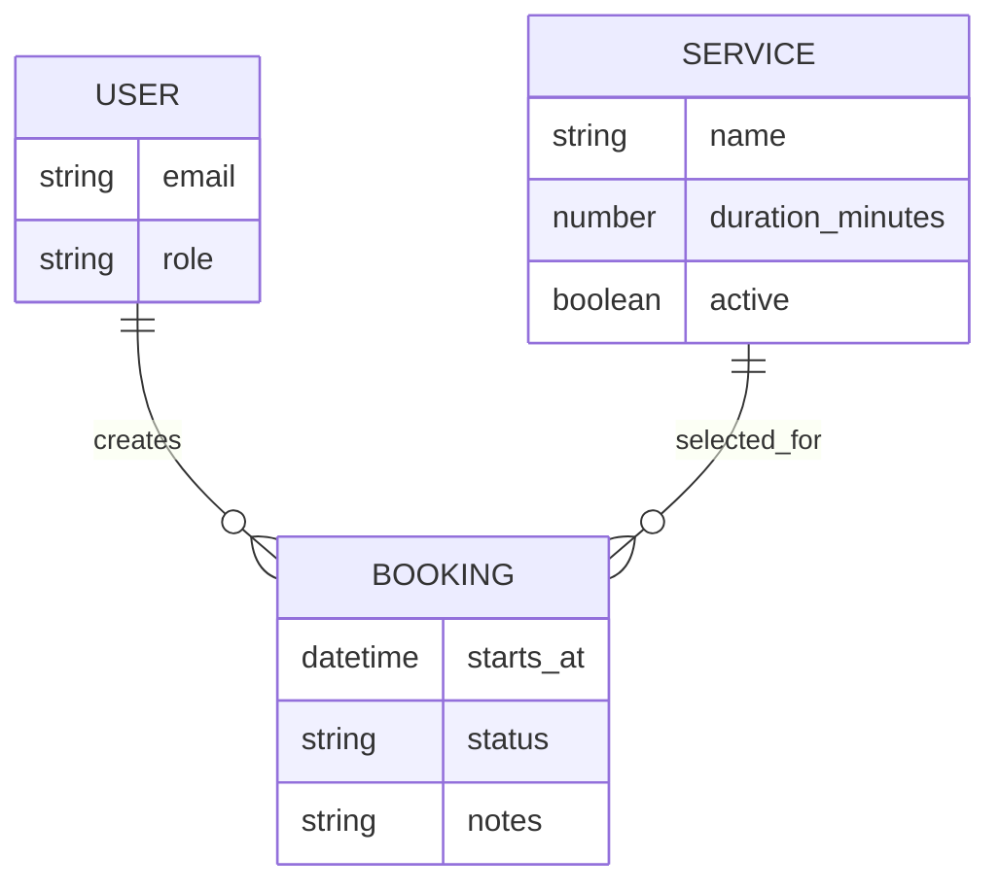

# Data, authentication, and security

AI can create a database and login flow quickly. That does not remove your responsibility to decide who should see each record.

This chapter is intentionally conservative. If your app handles medical, financial, legal, employment, children's, identity, or other highly sensitive data, get qualified security and legal review before collecting real information.

## Data in plain language

Base44 organizes app data into tables. A table represents one kind of thing; fields describe it; records are individual instances.

For a booking app:



You do not need to know diagram syntax to use Base44. The important questions are:

- What things exist?
- What must be stored about each thing?
- How are the things related?
- Who owns each record?
- Who may create, read, update, and delete it?

## Design tables before screens

For each table, write a sentence:

> A **Booking** belongs to one user, selects one service, occurs at one date/time, and has a status.

Then list the minimum fields. Do not store the same fact in multiple places unless you have a deliberate reason. Duplicate facts drift apart.

Useful field choices include text, number, yes/no, date/time, file, reference, and object. Use a Reference when one record links to another. Store phone numbers, postal codes, and IDs as text when leading zeroes or formatting matter.

## Separate identity, role, and ownership

These are different:

- **Identity:** who the signed-in person is
- **Role:** what category of access they have, such as Admin or User
- **Ownership:** which records belong to them

An app can correctly require login but still expose every user's records. Authentication answers “who are you?” Authorization answers “may you access this?”

## Build a permission matrix

For every table, decide CRUD permissions:

| Table             | Role    | Create |     Read |   Update |   Delete |
| ----------------- | ------- | -----: | -------: | -------: | -------: |
| Public article    | Anyone  |     No |      Yes |       No |       No |
| Form submission   | Visitor |    Yes |       No |       No |       No |
| Form submission   | Admin   |    Yes |      Yes |      Yes |      Yes |
| Personal task     | Creator |    Yes | Own only | Own only | Own only |
| Team announcement | Member  |     No |      Yes |       No |       No |
| Team announcement | Admin   |    Yes |      Yes |      Yes |      Yes |

Base44's permissions include patterns such as All Users, Creator Only, Entity-User Field Comparison, and User Property Check. Choose the narrowest rule that supports the real workflow.

## Permission prompt

```text
Review permissions for every data table. Do not change them yet.

For each table, show a matrix of who can Create, Read, Update, and Delete records.
Include anonymous visitors, regular signed-in users, and admins. Explain whether
access is public, creator-only, based on a record field matching the user, or
based on a user property.

Flag any rule that could expose one user's private data to another user. Propose
least-privilege rules, then give me role-by-role tests. Wait for approval before
applying changes.
```

After approving changes, inspect the Permissions screen yourself.

## Common patterns

### Public form, private submissions

- Public can Create
- Public cannot Read, Update, or Delete
- Admin can Read, Update, and Delete

### Personal dashboard

- Login required
- User can operate on records they created
- Admin access is explicit, not assumed

### Assigned tasks or tickets

- A field such as `assigned_to` or `owner_email` matches the signed-in user
- Admin access uses a separate role rule

### Multi-tenant product

- Records and users share a tenant/company ID
- Every tenant-scoped table enforces the match
- Admin means tenant admin unless you intentionally create a global admin
- Cross-tenant tests are mandatory

Multi-tenant authorization is not a good first app. A single missed rule can expose one customer's data to another.

## Secrets and external APIs

Never paste an API key into:

- A page or frontend component
- A prompt that may be stored in project history
- A public repository
- An error message
- Sample data

Use Base44 Secrets and backend functions for credentials. Backend functions require Builder or higher in the current plan lineup. If a key has been exposed, removing it from the UI is not enough—revoke or rotate it with the provider.

## Data imports and deletion

Base44's current import behavior appends rows; it does not overwrite existing records. That can create duplicates if you re-import the same file.

Before a large import:

1. Export the current table.
2. Remove real personal data from test files.
3. Confirm target table and field mapping.
4. Import a tiny sample.
5. Check types, references, duplicates, and permissions.
6. Import the rest.

Deleted records can currently be restored from Recently Deleted for 30 days. Do not treat that window as a backup strategy.

## Pre-publish security checklist

- [ ] App visibility is intentional
- [ ] Login requirement is intentional
- [ ] Every table has reviewed CRUD rules
- [ ] A regular user cannot see another user's records
- [ ] A visitor cannot query private form submissions
- [ ] Admin-only pages also enforce data permissions
- [ ] API keys and tokens are stored as Secrets
- [ ] Logs and errors do not expose sensitive values
- [ ] File uploads restrict type/size as appropriate
- [ ] Destructive actions require confirmation
- [ ] The app was tested as visitor, user, and admin
- [ ] Base44 security scan was run and findings resolved
- [ ] Real-user data is backed up and governed by an appropriate privacy policy

## Platform facts worth knowing

Base44's official security overview says it encrypts data at rest and in transit and provides app-level security tooling. It also says app creators remain responsible for app security settings. The same page currently notes that auth tokens are stored in browser localStorage and that per-app HTTP security headers and CORS rules are not configurable. Review those constraints if your threat model is strict.

Official references: [security overview](https://docs.base44.com/Setting-up-your-app/security-overview), [data permissions](https://docs.base44.com/Setting-up-your-app/Managing-security-settings), and [managing data](https://docs.base44.com/Building-your-app/Managing-your-app-data).
