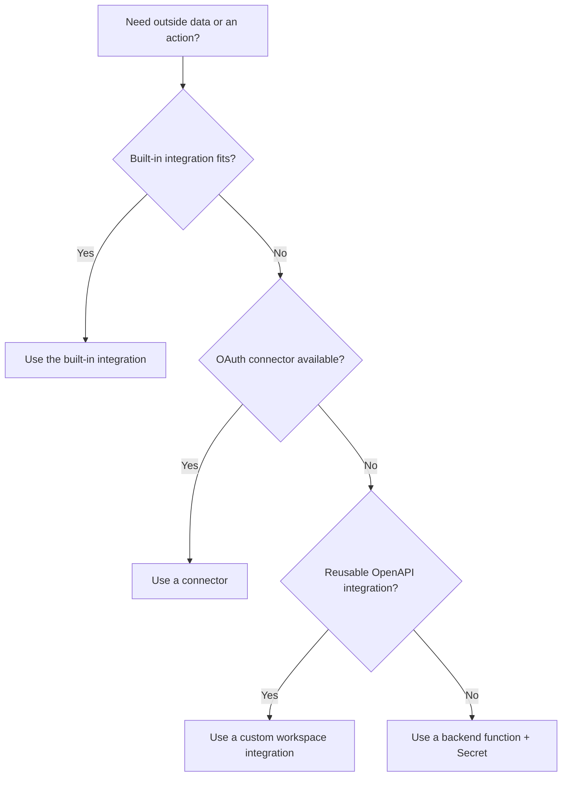

# Integrations, functions, and workflows

An integration makes your app communicate with another service. A workflow coordinates steps. An automation runs work on a trigger or schedule. A backend function gives you custom server-side logic.

Start with the simplest option that meets the need.



Availability and plan requirements change. Check [Using Integrations](https://docs.base44.com/Integrations/Using-integrations) before committing to an architecture.

## Built-in integrations

Base44 documents built-in capabilities for common jobs such as invoking an LLM, sending email, handling files, generating images, and extracting data. They are the best first choice when they fit because you avoid managing a separate provider key and custom request code.

Prompt pattern:

```text
When a new SupportTicket is created, send the user a short confirmation email.
Include the ticket ID and expected response time. Do not include internal notes.
If sending fails, keep the ticket, log a safe error, and let an admin retry.
Prevent duplicate confirmations for the same ticket.
```

The final three sentences matter as much as “send an email.” They define failure and idempotency behavior.

## Connectors

Connectors use managed OAuth connections to tools such as Google Workspace, Slack, or GitHub. Decide whether the connection represents one shared account for the app or each user connecting their own account.

Before connecting, answer:

- Whose account is authorized?
- Which scopes are requested?
- Can every user trigger the action?
- What happens if authorization expires?
- Where will failures be visible?
- Can the action create duplicates?
- How does the user disconnect or delete synced data?

## Backend functions and secrets

Use a backend function when you need protected credentials, webhook endpoints, custom validation, or request/response transformation. Base44's current backend functions run on Deno with TypeScript and can be called through the SDK or an HTTP endpoint.

Safe function prompt:

```text
Add a backend function that creates a customer in [SERVICE].

Requirements:
- Read the API key from Base44 Secrets; never send it to the browser.
- Require an authenticated admin.
- Validate and normalize the input on the server.
- Send only the fields the provider requires.
- Handle timeouts, rate limits, and provider errors without exposing credentials.
- Make retries idempotent so one request cannot create duplicate customers.
- Log a request ID, outcome, and safe error category, but no secrets or full
  personal payloads.

Before implementing, show the request flow, secret name, permission check, and
test cases.
```

## Automations

Automations are useful for reminders, digests, cleanup, and data-driven actions. Design them as if they might run twice.

For a scheduled follow-up reminder:

```text
Every weekday at 8:00 AM in America/New_York, find open leads whose follow-up
time is overdue and that have not received a reminder today. Send the admin one
digest rather than one email per lead. Mark each included lead with the reminder
date only after the email succeeds.

Handle an empty result without sending an email. Make reruns safe and log the
count of included leads without logging their contact details.
```

Always specify timezone, qualifying records, duplicate prevention, success/failure ordering, and empty behavior.

## Payments are a special case

Payment workflows deserve a separate product and test plan. Base44 currently documents Base44 Payments powered by Wix and Stripe integration. Check availability, supported regions, fees, plan requirements, and current setup instructions in the official docs.

Before accepting money, define:

- Product and price source of truth
- Currency and taxes
- Test versus live environment
- Success, failure, cancellation, and retry behavior
- Duplicate webhook handling
- Refund and dispute workflow
- When access is granted and revoked
- Receipts and support contact
- Who can see transaction data

Never grant paid access only because a visitor landed on a success page. Confirm payment using the supported server-side/payment-provider flow.

## Integration test checklist

- [ ] Works with valid authorization
- [ ] Fails clearly when authorization is missing or expired
- [ ] Secrets never appear in browser code or logs
- [ ] Unauthorized roles cannot invoke it
- [ ] Duplicate clicks/events do not duplicate side effects
- [ ] Rate limits and timeouts have safe behavior
- [ ] Partial failure does not corrupt app state
- [ ] A user can understand whether the action completed
- [ ] There is a retry or recovery path
- [ ] Provider-side results match the Base44 record

Official references: [using integrations](https://docs.base44.com/Integrations/Using-integrations), [third-party API choices](https://docs.base44.com/developers/references/sdk/getting-started/third-party-apis), [backend functions](https://docs.base44.com/developers/backend/resources/backend-functions/overview), and [workflows](https://docs.base44.com/Building-your-app/Creating-workflows).
