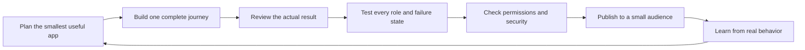
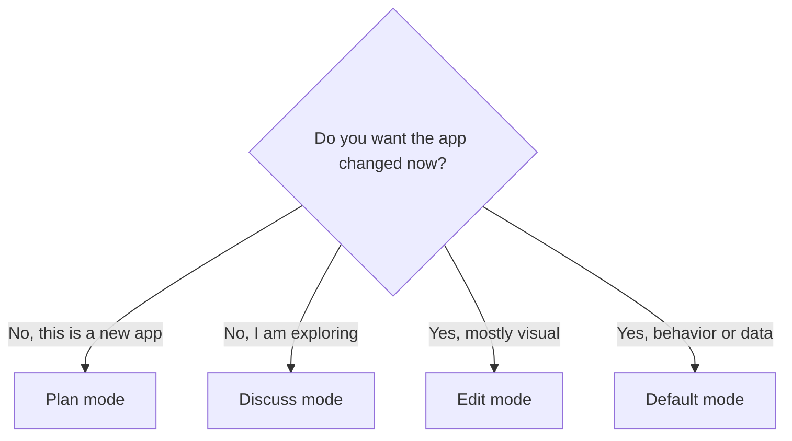

# Base44 quick reference

> **One-page field guide · Last verified July 27, 2026**

Keep this page open while you build. It condenses the workflow, mode choices,
prompt pattern, testing loop, and launch guardrails used throughout the course.

[← Course map](README.md) · [Prompt library](../prompts/README.md) ·
[Troubleshooting](troubleshooting.md) · [Launch checklist](06-launch-checklist.md)

## The operating system



**Plan → Build small → Review → Test → Secure → Publish → Learn.**

Do not ask the AI to build five journeys at once. Complete one thin slice from
the first click to the saved result, then expand.

## Which mode should I use?

| Your intent                                      | Best starting mode | What happens                                                    |
| ------------------------------------------------ | ------------------ | --------------------------------------------------------------- |
| Shape a brand-new app before the first build     | **Plan**           | Base44 asks questions and produces a plan without building yet. |
| Explore an idea inside an existing app           | **Discuss**        | You reason with the AI without changing the app.                |
| Make a specific functional change                | **Default**        | Base44 acts on the prompt.                                      |
| Adjust visible styling, spacing, copy, or layout | **Edit**           | You select elements and make targeted visual changes.           |

Plan mode currently does not use credits before the first build. Discuss mode
is designed as a lower-credit thinking mode, while manual changes in Edit mode
do not use message credits. Credit rules can change, so verify them in the
[official credit documentation](https://docs.base44.com/Account-and-billing/Credits).



## The prompt that works for most changes

```text
On [PAGE], when [ROLE] does [ACTION], change [CURRENT BEHAVIOR] so that
[EXPECTED BEHAVIOR].

Keep [WORKING AREAS, DATA MODEL, AND PERMISSIONS] unchanged.

Handle:
- [LOADING OR IN-PROGRESS STATE]
- [EMPTY OR INVALID STATE]
- [FAILURE AND RETRY STATE]

Done means:
- [OBSERVABLE HAPPY-PATH RESULT]
- [IMPORTANT EDGE-CASE RESULT]
- [THING THAT MUST NEVER HAPPEN]
```

The brackets force the useful decisions: location, role, action, boundaries,
failure behavior, and evidence. Delete any line that does not apply.

## Before sending a build prompt

- [ ] I named one page or flow.
- [ ] I named the user or role.
- [ ] I described observable behavior, not vague quality words.
- [ ] I said what must remain unchanged.
- [ ] I included at least one failure or permission case.
- [ ] I know how I will prove the change worked.

If three or more boxes are unchecked, switch to Discuss mode and clarify first.

## Credit-smart workflow

1. Think through unclear decisions in Plan or Discuss mode.
2. Ask for one coherent outcome per build prompt.
3. Use Edit mode for small visual changes.
4. Inspect the result before sending another prompt.
5. Use the actual **Revert** control or **Version History** when a direction is
   wrong. Asking the chat to “undo” is not the same operation.
6. Diagnose with evidence before paying for repeated guesses.

## Debug in this order

1. **Reproduce:** write the exact page, role, starting state, action, expected
   result, and actual result.
2. **Reduce:** isolate the smallest failing flow.
3. **Inspect:** check data, permissions, logs, and recent changes.
4. **Explain:** use Discuss mode to rank likely causes before editing.
5. **Fix small:** preserve working behavior and avoid unrelated refactors.
6. **Retest:** run the original failure plus a nearby regression test.

Copy the complete [diagnostic prompt](../prompts/README.md#diagnose-a-bug) when
you need help.

## Permission test you should never skip

For every private table, test as:

- **Signed out:** cannot read private records or internal fields.
- **User A:** can access only the records User A is allowed to access.
- **User B:** cannot access User A's records by navigation, search, or direct URL.
- **Admin:** has only the explicitly intended administrative access.

Hiding a page or button is not authorization. Review the underlying data rules,
then run Base44's security scan before launch and after meaningful data,
permission, or integration changes.

## Five-minute launch gate

- [ ] The primary journey works on desktop and mobile.
- [ ] Required fields fail clearly and preserve useful input.
- [ ] Repeated clicks do not create duplicate records or actions.
- [ ] Empty, loading, success, permission-denied, and failure states make sense.
- [ ] Cross-user access tests pass.
- [ ] No key, token, password, or private value appears in browser code or logs.
- [ ] The security scan has been reviewed, not merely run.
- [ ] The live URL was tested after publishing.
- [ ] A real person who did not build the app can complete the main task.

Use the full [launch checklist](06-launch-checklist.md) before a public release.

## Useful shortcuts and recovery moves

| Situation                    | Move                                                                  |
| ---------------------------- | --------------------------------------------------------------------- |
| Find something in the editor | Press `Ctrl+K` on Windows or `Cmd+K` on macOS.                        |
| A prompt changed too much    | Use **Revert** beneath that prompt or restore **Version History**.    |
| A small visual detail is off | Select the element in **Edit** mode and adjust it directly.           |
| The AI keeps guessing        | Switch to **Discuss**, provide evidence, and ask for likely causes.   |
| Preview and live disagree    | Republish, reload the live URL, and test the same role and data.      |
| You may expose private data  | Stop, review permissions, and run cross-user tests before continuing. |

## Official references

- [Build an app](https://docs.base44.com/Getting-Started/Quick-start-guide)
- [Write effective prompts](https://docs.base44.com/Getting-Started/Prompt-guide)
- [Use AI chat modes](https://docs.base44.com/Building-your-app/AI-chat-modes)
- [Manage data permissions](https://docs.base44.com/Setting-up-your-app/Managing-security-settings)
- [Run a security scan](https://docs.base44.com/Setting-up-your-app/running-a-security-scan)
- [Understand credits](https://docs.base44.com/Account-and-billing/Credits)

---

[← Course map](README.md) · [Choose a starter kit →](../starter-kits/README.md)
